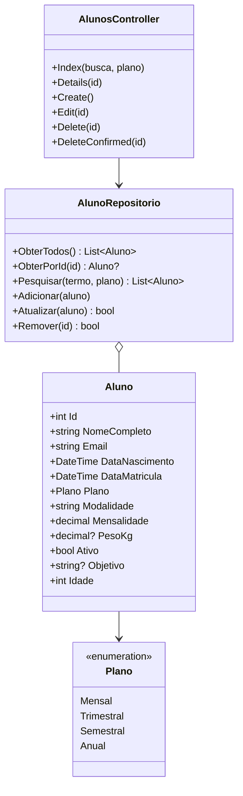
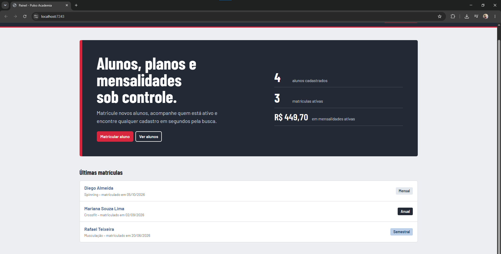
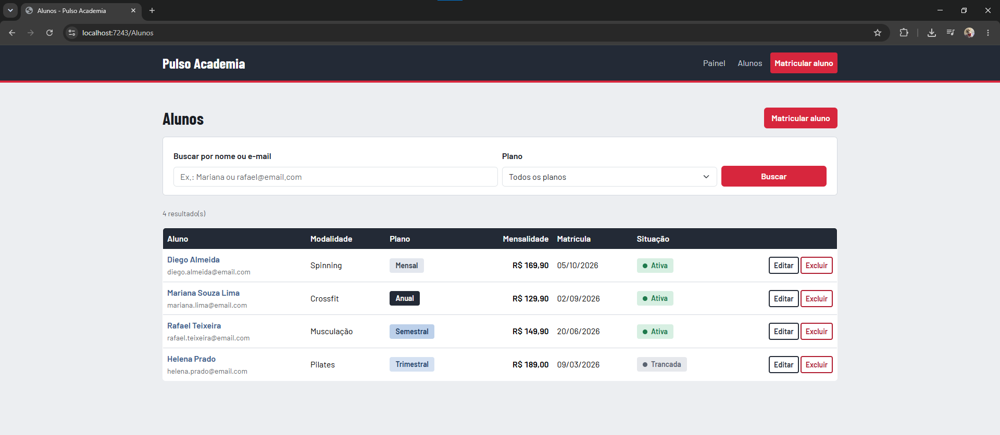
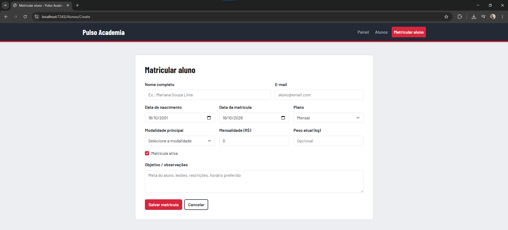
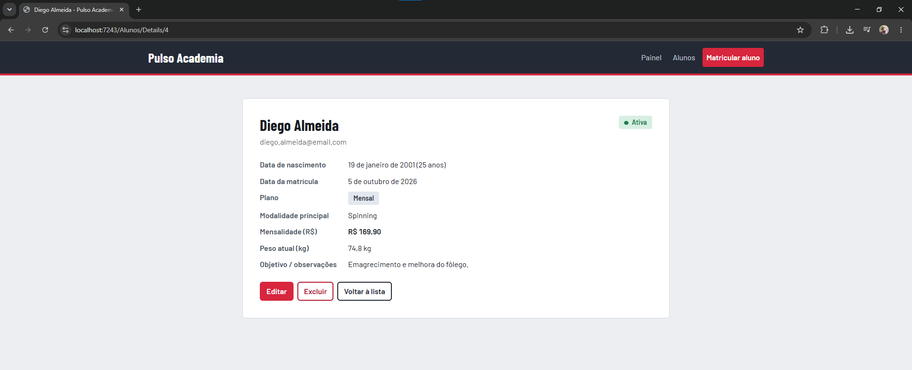
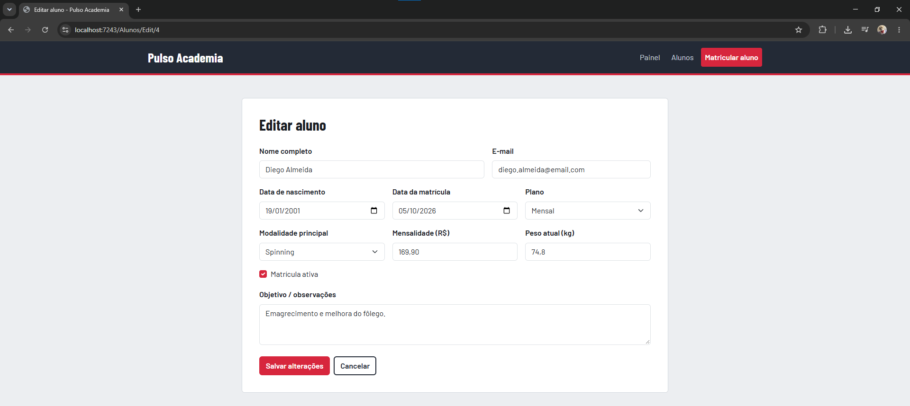
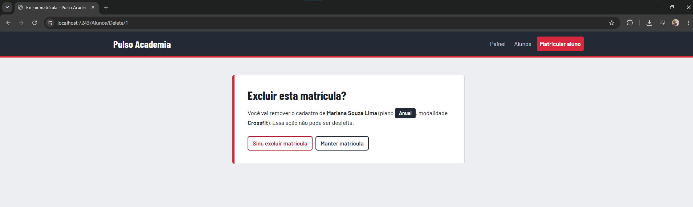

# Pulso Academia

Integrantes do grupo

Lucas Shida Rodrigues da Costa - RM568194
Matheus Guimarães Rosa - RM567912
Pedro Henrique Pinheiro Falchi - RM566967


Disciplina: Checkpoint 2 – Advanced Business Development with dotNet
Professor: Marcel Stefan Wagner

---

## 1. Sobre o projeto

O Pulso Academia é uma aplicação web em ASP.NET Core MVC (.NET 8) para a recepção de uma academia. Ela permite matricular alunos, escolher plano e modalidade, acompanhar quem está com a matrícula ativa, ver o valor total das mensalidades ativas e encontrar qualquer cadastro pela busca.

Conforme o enunciado, não há banco de dados: os dados ficam em uma lista em memória (`List<Aluno>`) dentro de um serviço registrado como Singleton. Ao reiniciar a aplicação, os dados voltam ao conjunto de exemplos.

## 2. Requisitos do checkpoint e onde foram atendidos

| Requisito | Onde está |
|---|---|
| CRUD no navegador | `Controllers/AlunosController.cs` + `Views/Alunos/*` |
| Pesquisa por propriedade do modelo | `AlunosController.Index` (busca por nome/e-mail e filtro por plano) → `AlunoRepositorio.Pesquisar` |
| Diferentes tipos de dados | `Models/Aluno.cs`: `string`, `DateTime`, `enum`, `decimal`, `decimal?`, `bool` e propriedade calculada `int Idade` |
| Opção escolhida pelo usuário com dados vindos do Controller | Dropdown Modalidade (`SelectList` montada em `AlunosController.CarregarModalidades`) e dropdown Plano (enum) |
| Tag Helpers criados | `TagHelpers/PlanoBadgeTagHelper.cs`, `StatusMatriculaTagHelper.cs`, `ValorBrlTagHelper.cs`, `DataBrTagHelper.cs` |
| Layout | `Views/Shared/_Layout.cshtml` + `wwwroot/css/site.css` |
| Confirmação de remoção | Tela `Views/Alunos/Delete.cshtml` (GET); a exclusão só ocorre no POST |
| Sem banco de dados | `Services/AlunoRepositorio.cs` (lista em memória) |

## 3. Tecnologias, pacotes e configuração

- Visual Studio 2022 ou 2026 com a carga de trabalho *ASP.NET e desenvolvimento para a Web
- .NET 8 (`net8.0`), SDK `Microsoft.NET.Sdk.Web`
- Nenhum pacote NuGet adicional (apenas o framework `Microsoft.AspNetCore.App`, que já vem com o SDK)
- Bibliotecas de front-end carregadas por CDN (é preciso internet para ver o visual completo):
  - Bootstrap 5.3.3
  - jQuery 3.7.1, jQuery Validation 1.19.5 e jQuery Validation Unobtrusive 4.0.0
  - Fontes Google: Barlow Condensed* e *Barlow
- Padrões usados: MVC, injeção de dependência (`AddSingleton<AlunoRepositorio>`), *Data Annotations* para validação, regras de negócio no controller (`ValidarRegrasDeNegocio`), padrão **PRG** (Post/Redirect/Get) após salvar, `TempData` para mensagens de sucesso.
- Cultura invariante configurada em `Program.cs` com `UseRequestLocalization`: faz os campos numéricos aceitarem ponto decimal em qualquer computador. A exibição em português (datas e R$) é feita pelos Tag Helpers com `CultureInfo("pt-BR")`.

### Como executar

1. Abra `PulsoAcademia.sln` no Visual Studio.
2. Selecione o perfil PulsoAcademia (ou https) e pressione F5.
3. O navegador abre em `https://localhost:7243`.

## 4. Estrutura de pastas

```
PulsoAcademia.sln
PulsoAcademia/
├── Controllers/
│   ├── HomeController.cs        # painel com resumo
│   └── AlunosController.cs      # CRUD + pesquisa + regras de negócio
├── Models/
│   ├── Aluno.cs                 # modelo + validações
│   ├── Plano.cs                 # enum
│   └── ErrorViewModel.cs
├── Services/
│   └── AlunoRepositorio.cs      # "banco" em memória
├── TagHelpers/
│   ├── PlanoBadgeTagHelper.cs
│   ├── StatusMatriculaTagHelper.cs
│   ├── ValorBrlTagHelper.cs
│   └── DataBrTagHelper.cs
├── Views/
│   ├── Home/Index.cshtml
│   ├── Alunos/ (Index, Details, Create, Edit, Delete, _Form)
│   └── Shared/ (_Layout, _ValidationScriptsPartial, Error)
├── wwwroot/css/site.css
├── Program.cs
└── PulsoAcademia.csproj
docs/                            # prints das telas
```

## 5. Diagrama de classes



## 6. Endpoints (rotas MVC)

| Método | Rota | Ação |
|---|---|---|
| GET | `/` | Painel inicial |
| GET | `/Alunos` | Lista de alunos |
| GET | `/Alunos?busca=maria&plano=3` | Pesquisa por nome/e-mail e/ou plano |
| GET | `/Alunos/Details/{id}` | Detalhes de um aluno |
| GET | `/Alunos/Create` | Formulário de matrícula |
| POST | `/Alunos/Create` | Salva a nova matrícula |
| GET | `/Alunos/Edit/{id}` | Formulário de edição |
| POST | `/Alunos/Edit/{id}` | Salva as alterações |
| GET | `/Alunos/Delete/{id}` | Tela de confirmação de exclusão |
| POST | `/Alunos/Delete/{id}` | Exclui após confirmação |

## 7. Tag Helpers criados

| Tag Helper | Uso na View | O que faz |
|---|---|---|
| `PlanoBadgeTagHelper` | `<plano-badge valor="@aluno.Plano"></plano-badge>` | Selo com o nome do plano (lido do `[Display]` do enum), com cor diferente por plano |
| `StatusMatriculaTagHelper` | `<status-matricula ativo="aluno.Ativo"></status-matricula>` | Mostra "Ativa" (verde) ou "Trancada" (cinza) |
| `ValorBrlTagHelper` | `<valor-brl valor="aluno.Mensalidade"></valor-brl>` | Formata decimal como moeda brasileira (R$ 149,90) |
| `DataBrTagHelper` | `<data-br valor="aluno.DataMatricula" curta="true"></data-br>` | Gera `<time>` com data em português (por extenso ou `dd/MM/yyyy`) |

Registrados em `Views/_ViewImports.cshtml` com `@addTagHelper *, PulsoAcademia`.

## 8. Regras de validação

Além das Data Annotations do modelo (campos obrigatórios, e-mail válido, tamanhos e faixas), o controller aplica:

- A data de nascimento não pode estar no futuro.
- A idade mínima para matrícula é 14 anos.
- A matrícula não pode ser agendada para mais de 30 dias à frente.

## 9. Telas

Abaixo, os textos explicativos de cada tela já estão prontos.

### 9.1 Painel inicial (`/`)


Implementada em `Views/Home/Index.cshtml` e `HomeController.Index`. O controller calcula o total de alunos, quantos estão ativos e a soma das mensalidades das matrículas ativas, e envia os números por `ViewBag`. A soma é exibida com o Tag Helper `valor-brl`. A tela também lista as três matrículas mais recentes.

### 9.2 Lista e pesquisa (`/Alunos`)


Implementada em `Views/Alunos/Index.cshtml`. Um formulário `GET` envia `busca` (texto) e `plano` (dropdown do enum) para `AlunosController.Index`, que chama `AlunoRepositorio.Pesquisar`. A busca ignora maiúsculas e procura no nome e no e-mail. A tabela usa os Tag Helpers `plano-badge`, `valor-brl`, `data-br` e `status-matricula`. Quando nada é encontrado, aparece uma mensagem com link para limpar os filtros.

### 9.3 Matrícula (`/Alunos/Create`)


Formulário em `Views/Alunos/Create.cshtml`, que reutiliza o parcial `_Form.cshtml`. Reúne tipos variados: texto, e-mail, datas (`DateTime`), dropdown de enum (Plano), dropdown com lista vinda do Controller (Modalidade), valores numéricos (`decimal`), checkbox (`bool`) e área de texto. A validação roda no navegador e no servidor (`ModelState.IsValid`), incluindo as regras de negócio da seção 8. Ao salvar, o usuário volta à lista com uma mensagem de sucesso (`TempData`).

### 9.4 Detalhes (`/Alunos/Details/{id}`)


`Views/Alunos/Details.cshtml` mostra todos os dados do aluno, incluindo a idade calculada a partir da data de nascimento, com os Tag Helpers aplicados, e oferece atalhos para editar, excluir ou voltar.

### 9.5 Edição (`/Alunos/Edit/{id}`)


`Views/Alunos/Edit.cshtml` reaproveita `_Form.cshtml`, já preenchido. O `Id` vai em campo oculto. No POST, o controller confere se o `id` da rota é igual ao do modelo, reaplica as validações e chama `AlunoRepositorio.Atualizar`.

### 9.6 Confirmação de exclusão (`/Alunos/Delete/{id}`)


`Views/Alunos/Delete.cshtml` mostra o resumo do aluno e pergunta se a matrícula deve mesmo ser excluída. A exclusão só acontece no botão "Sim, excluir matrícula", que envia um `POST` para `DeleteConfirmed`. Em "Manter matrícula", nada é apagado.

## 10. Testes manuais realizados

| Teste | Resultado esperado |
|---|---|
| Matricular aluno com todos os campos | Aparece na lista com mensagem de sucesso |
| Matricular com nome vazio ou e-mail inválido | Mensagens de validação, nada é salvo |
| Informar nascimento que resulte em menos de 14 anos | Erro de idade mínima |
| Buscar "mariana" | Só a Mariana aparece |
| Filtrar por plano Anual | Só alunos do plano anual aparecem |
| Editar mensalidade | Valor atualizado na lista, nos detalhes e no total do painel |
| Desmarcar "Matrícula ativa" | Situação passa a "Trancada" e o total do painel diminui |
| Excluir e confirmar | Aluno some da lista |
| Excluir e cancelar | Aluno continua na lista |

